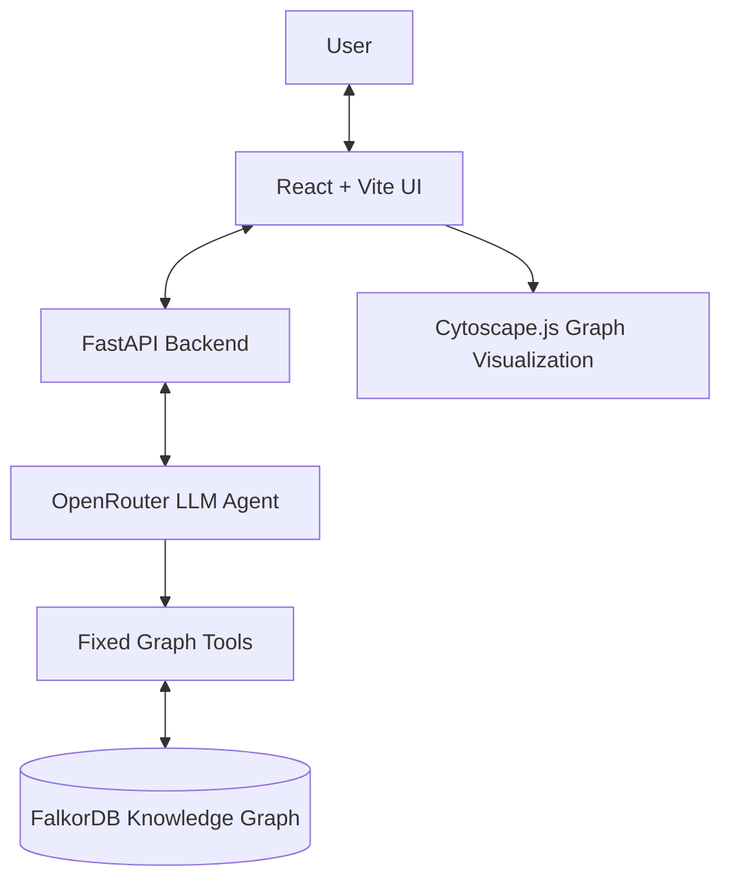

# Company Brain

**An evidence-first AI assistant for exploring company knowledge and system dependencies.**

Company Brain is a full-stack prototype that lets users ask natural-language questions about a fictional company, NovaTech. It combines an LLM-powered tool-calling agent with a FalkorDB knowledge graph so answers about people, teams, systems, technical decisions, and incidents can be grounded in structured graph data.

> **Demo data notice:** NovaTech and the company records in this repository are synthetic. They are for demonstration only and do not represent a real organization.

## Why Company Brain?

Company information is often spread across ownership records, architecture decisions, incident reports, and knowledge held by individual team members. Answering a question can require connecting several pieces of information.

Company Brain represents that information as a graph and provides an AI interface for querying it. Its focus is not just generating an answer, but making the underlying graph-tool evidence inspectable and allowing users to explore related entities visually.

## Features

- **Natural-language AI chat:** Ask company-specific questions through an LLM agent using OpenRouter.
- **Evidence-backed tool calls:** The agent calls a fixed set of backend tools and returns tool evidence alongside its answer.
- **System ownership history:** Look up current ownership and historical ownership periods.
- **Expert discovery:** Find people connected to a project, incident, or document topic in the graph.
- **Dependency blast-radius analysis:** Traverse directed `DEPENDS_ON` relationships to find downstream systems.
- **Decision tracing:** Explore a decision's maker, selected technology, affected system, and supporting document.
- **Incident investigation:** Retrieve an incident's affected systems, resolver, and linked supporting document.
- **Change history:** Query recorded ownership changes over a date range.
- **Interactive knowledge graph:** Explore graph nodes and relationships, filter entity types, inspect individual elements, and highlight entities and pathways related to answers.
- **API health endpoint:** Check whether the backend can communicate with FalkorDB.

## Example Questions

- "Who currently owns the Payment Gateway, and what was the previous owner?"
- "If Payment Gateway fails, which downstream systems could be affected, and why?"
- "Who has experience related to Payment Modernization?"
- "Trace the decision to adopt PostgreSQL for the Transaction Service."
- "Investigate the Payment Processing Timeout incident."
- "What ownership changes were recorded between 2026-01-01 and 2026-12-31?"

Answers depend on the entities and relationships currently seeded in the graph. The model can still make mistakes; inspect the returned evidence rather than treating generated text as infallible.

## Architecture



### Technology Stack

| Layer | Technology | Responsibility |
|---|---|---|
| Frontend | React, Vite | User interface and development/build workflow |
| Graph visualization | Cytoscape.js, react-cytoscapejs | Interactive graph rendering and exploration |
| Backend API | Python, FastAPI, Pydantic | REST endpoints and request validation |
| AI integration | OpenAI-compatible client through OpenRouter | LLM responses and tool selection |
| Knowledge store | FalkorDB | Company entities, properties, and relationships |
| Local database runtime | Docker Compose | Run FalkorDB with persistent storage |

## Graph Model

The graph schema defines the following node labels:

- `Person`
- `Team`
- `Project`
- `System`
- `Technology`
- `Document`
- `Decision`
- `Incident`

Relationships capture connections such as `MEMBER_OF`, `WORKED_ON`, `AUTHORED`, `OWNS`, `USES`, `DEPENDS_ON`, `DESCRIBES`, `MADE`, `CHOOSES`, `AFFECTS`, `SUPPORTED_BY`, `AFFECTED`, and `RESOLVED`.

For example, the seeded dependency chain is:

```text
Payment Gateway
    └── DEPENDS_ON → Transaction Service
                         └── DEPENDS_ON → Ledger Service
```

The core graph seed creates the NovaTech entities and relationships. A separate script adds the synthetic Payment Processing Timeout incident and its postmortem.

## Repository Structure

```text
company-brain/
├── backend/
│   ├── app/
│   │   ├── agent/          # LLM agent and tool-calling loop
│   │   ├── graph/          # FalkorDB connection, schema, seed data
│   │   ├── tools/          # Six graph query tools
│   │   └── main.py         # FastAPI routes
│   ├── .env.example        # Example backend configuration
│   ├── requirements.txt    # Python dependencies
│   ├── add_incident_data.py
│   ├── diagnose_queries.py
│   └── test_*.py           # Backend tests
├── frontend/
│   ├── src/
│   │   ├── styles/         # Application stylesheets
│   │   ├── App.jsx
│   │   ├── GraphView.jsx
│   │   └── ...
│   ├── package.json
│   └── pnpm-lock.yaml
├── docker-compose.yaml
├── .gitignore
└── README.md
```

## Prerequisites

Install the following before starting:

- Git
- Docker Desktop with Docker Compose
- Python 3.11 or newer recommended
- Node.js compatible with the installed Vite version
- pnpm
- An OpenRouter API key for AI chat

## Setup Guide (Windows PowerShell)

Follow these steps to run Company Brain locally from a fresh clone.

### 1. Clone the Repository

Open PowerShell and run:

```powershell
git clone https://github.com/sarthugx/company-brain.git
cd company-brain
```

### 2. Start FalkorDB

Ensure Docker Desktop is running, then execute:

```powershell
docker compose up -d
docker compose ps
```

The Compose configuration exposes:

- **Port 6379:** FalkorDB database connection
- **Port 3000:** FalkorDB web interface

Database files are stored in the named Docker volume `falkordb_data`, allowing the database to persist across container restarts.

### 3. Configure Backend Environment Variables

From the repository root, copy the example environment file:

```powershell
Copy-Item .\backend\.env.example .\backend\.env
```

Open `backend/.env` in a text editor and replace `your_api_key_here` with your own OpenRouter API key.

The configuration should contain the following settings:

```dotenv
# FalkorDB Configuration
FALKORDB_HOST=127.0.0.1
FALKORDB_PORT=6379
FALKORDB_GRAPH=company_brain
FALKORDB_PROTOCOL=2

# OpenRouter Configuration
OPENROUTER_API_KEY=your_api_key_here
OPENROUTER_MODEL=openrouter/free
```

Keep your real API key private. Never commit `backend/.env` or share its contents. The repository includes `backend/.env.example` for safe configuration sharing.

### 4. Install Backend Dependencies

From the repository root, execute:

```powershell
cd backend
python -m venv .venv
.\.venv\Scripts\Activate.ps1
python -m pip install --upgrade pip
python -m pip install -r requirements.txt
```

If PowerShell blocks virtual environment activation, you can use the virtual environment's Python executable directly:

```powershell
.\.venv\Scripts\python.exe -m pip install -r requirements.txt
```

If the `python` command is unavailable, install Python and ensure it is available on your system PATH.

### 5. Seed the Knowledge Graph

Ensure FalkorDB is running and the backend environment is configured. Run these commands from the `backend` directory with the virtual environment active:

```powershell
python -m app.graph.seed
python add_incident_data.py
```

The first command creates the core NovaTech entities and relationships. The second adds the synthetic Payment Processing Timeout incident and its postmortem, linking them to existing entities.

Run the core seed before the incident-data script because the incident script expects the relevant systems and people to exist.

Both scripts are designed to use `MERGE` for their primary graph records and relationships, allowing the seed operations to be rerun without duplicating the same records.

Optional: initialize graph lookup indexes if needed:

```powershell
python -m app.graph.schema
```

**Important:** Starting the backend does not automatically seed the graph. These commands are required when initializing an empty database.

### 6. Start the Backend

From the `backend` directory, with the virtual environment active, run:

```powershell
uvicorn app.main:app --reload
```

The backend runs at:

- **API base URL:** http://127.0.0.1:8000
- **Interactive API documentation:** http://127.0.0.1:8000/docs
- **Health check:** http://127.0.0.1:8000/api/health

A healthy response indicates that the backend can communicate with the graph database.

Keep this terminal running.

### 7. Install and Start the Frontend

Open a **second PowerShell terminal**. Navigate to the frontend directory inside your cloned repository.

For example, if you cloned the repository into `D:\PROJECTS\company-brain`, run:

```powershell
cd D:\PROJECTS\company-brain\frontend
pnpm install
pnpm dev
```

Use the local URL printed by Vite, usually:

http://localhost:5173

The current frontend is configured to communicate with the backend at `http://127.0.0.1:8000`.

Keep both the backend and frontend terminals running while using the application.

## API Overview

The backend exposes the following endpoints:

| Method | Endpoint | Purpose |
|---|---|---|
| `GET` | `/api/health` | Check backend-to-FalkorDB connectivity |
| `GET` | `/api/owner/{system_id}` | Retrieve system ownership |
| `GET` | `/api/experts?topic=...` | Find relevant experts |
| `GET` | `/api/blast-radius/{system_id}?max_depth=5` | Traverse downstream dependencies |
| `GET` | `/api/decisions/{decision_id}` | Trace a technical decision |
| `GET` | `/api/incidents/{incident_id}` | Investigate an incident |
| `GET` | `/api/changes?start_date=YYYY-MM-DD&end_date=YYYY-MM-DD` | Query recorded changes |
| `POST` | `/api/chat` | Ask the AI assistant |
| `GET` | `/api/graph` | Retrieve nodes and relationships for visualization |

### Example Chat Request

Send a `POST` request to `/api/chat` with JSON such as:

```json
{
  "question": "If Payment Gateway fails, which downstream systems could be affected, and why?"
}
```

The chat response includes an answer, the model identifier, and evidence collected from graph-tool calls.

## Testing and Quality Checks

### Backend Tests

From the `backend` directory with the virtual environment activated, run:

```powershell
python -m pytest -v
```

### Frontend Production Build

From the `frontend` directory, run:

```powershell
pnpm build
```

### Frontend Lint

From the `frontend` directory, run:

```powershell
pnpm lint
```

Run these checks after making changes or when validating a fresh checkout.

## Troubleshooting

### FalkorDB Is Not Reachable

1. Ensure Docker Desktop is running.
2. Check the database container:

   ```powershell
   docker compose ps
   ```

3. Confirm `backend/.env` uses the correct host and port.
4. Check the container logs if the database is not healthy:

   ```powershell
   docker compose logs falkordb
   ```

### Backend Cannot Find Its Environment Variables

- Confirm that `backend/.env` exists.
- Ensure you copied it from `backend/.env.example`.
- Verify that the OpenRouter API key is valid and that the model setting is configured correctly.

### The Application Shows No Graph Data

- Confirm FalkorDB is running.
- Run both graph-seeding commands from the `backend` directory.
- Restart the backend if necessary.

### AI Chat Does Not Work

- Check that the backend is running.
- Verify your OpenRouter API key and model configuration.
- Inspect the backend terminal for API or tool-calling errors.

## Limitations

- The dataset is synthetic and intentionally small; this is a hackathon prototype, not a production company knowledge system.
- Answers depend on graph completeness, correctness, and the language model's tool-calling behavior.
- The graph seed and incident-data script are separate manual setup steps; startup does not automatically populate the graph.
- A working OpenRouter API key and a reachable FalkorDB instance are required for full AI-chat functionality.
- The current frontend backend URL is configured for local development; deployment requires environment-specific configuration and suitable CORS settings.
- The project does not claim production-grade authentication, authorization, or multi-tenant isolation.

## Future Improvements

- Automate and validate first-run graph initialization.
- Add ingestion workflows for real documents with provenance and update tracking.
- Add authentication, authorization, and deployment configuration.
- Expand graph and agent tests, including tool-call failure and missing-evidence scenarios.

## License

Add a `LICENSE` file before distributing the project under a specific open-source license. Until a license is included, do not assume that others have permission to reuse, modify, or redistribute the code.
