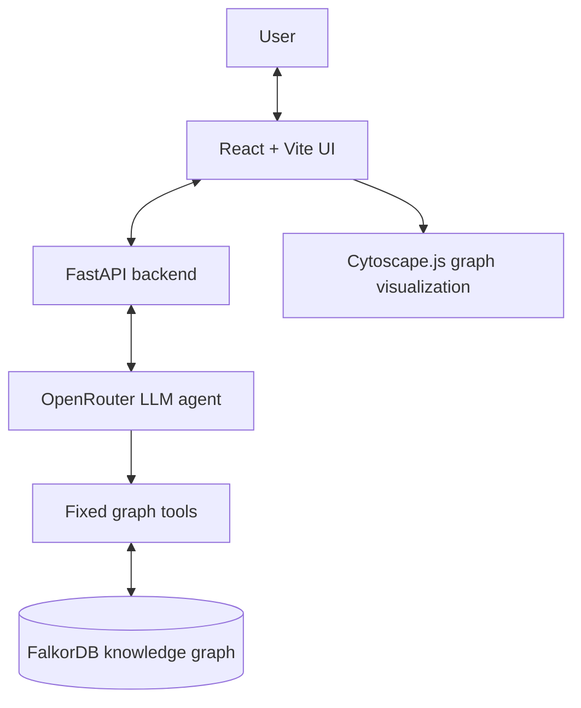

# Company Brain

**An evidence-first AI assistant for exploring company knowledge and system dependencies.**

Company Brain is a full-stack prototype that lets users ask natural-language questions about a fictional company, NovaTech. It combines an LLM-powered tool-calling agent with a FalkorDB knowledge graph so answers about people, teams, systems, technical decisions, and incidents can be grounded in structured graph data.

> **Demo data notice:** NovaTech and the company records in this repository are synthetic. They are for demonstration only and do not represent a real organization.

## Why Company Brain?

Company information is often spread across ownership records, architecture decisions, incident reports, and knowledge held by individual team members. Answering a question can require connecting several pieces of information.

Company Brain represents that information as a graph and provides an AI interface for querying it. Its focus is not just generating an answer, but making the underlying graph-tool evidence inspectable and allowing users to explore related entities visually.

## Features

- **Natural-language AI chat:** Ask company-specific questions through an LLM agent using OpenRouter.
- **Evidence-backed tool calls:** The agent can call a fixed set of backend tools and returns tool evidence alongside its answer.
- **System ownership history:** Look up current ownership and historical ownership periods.
- **Expert discovery:** Find people connected to a project, incident, or document topic in the graph.
- **Dependency blast-radius analysis:** Traverse directed `DEPENDS_ON` relationships to find downstream systems.
- **Decision tracing:** Explore a decision's maker, selected technology, affected system, and supporting document.
- **Incident investigation:** Retrieve an incident's affected systems, resolver, and linked supporting document.
- **Change history:** Query recorded ownership changes over a date range.
- **Interactive knowledge graph:** Explore graph nodes and relationships, filter entity types, inspect individual elements, and highlight entities/pathways related to answers.
- **API health endpoint:** Check whether the backend can communicate with FalkorDB.

## Example questions

- “Who currently owns the Payment Gateway, and what was the previous owner?”
- “If Payment Gateway fails, which downstream systems could be affected, and why?”
- “Who has experience related to Payment Modernization?”
- “Trace the decision to adopt PostgreSQL for the Transaction Service.”
- “Investigate the Payment Processing Timeout incident.”
- “What ownership changes were recorded between 2026-01-01 and 2026-12-31?”

Answers depend on the entities and relationships currently seeded in the graph. The model can still make mistakes; inspect the returned evidence rather than treating generated text as infallible.

## Architecture



### Technology stack

| Layer | Technology | Responsibility |
|---|---|---|
| Frontend | React, Vite | User interface and development/build workflow |
| Graph visualization | Cytoscape.js, react-cytoscapejs | Interactive graph rendering and exploration |
| Backend API | Python, FastAPI, Pydantic | REST endpoints and request validation |
| AI integration | OpenAI-compatible client through OpenRouter | LLM responses and tool selection |
| Knowledge store | FalkorDB | Company entities, properties, and relationships |
| Local database runtime | Docker Compose | Run FalkorDB with persistent storage |

## Graph model

The graph schema defines these node labels:

- `Person`
- `Team`
- `Project`
- `System`
- `Technology`
- `Document`
- `Decision`
- `Incident`

Relationships capture connections such as `MEMBER_OF`, `WORKED_ON`, `AUTHORED`, `OWNS`, `USES`, `DEPENDS_ON`, `DESCRIBES`, `MADE`, `CHOOSES`, `AFFECTS`, `SUPPORTED_BY`, `AFFECTED`, and `RESOLVED`.

For example, the seeded dependency chain is:

```text
Payment Gateway
    └── DEPENDS_ON → Transaction Service
                         └── DEPENDS_ON → Ledger Service
```

The graph seed creates the core NovaTech entities and relationships. A separate script adds the synthetic payment-timeout incident and its postmortem.

## Repository structure

```text
company-brain/
├── backend/
│   ├── app/
│   │   ├── agent/          # LLM agent and tool-calling loop
│   │   ├── graph/          # FalkorDB connection, schema, seed data
│   │   ├── tools/          # Six graph query tools
│   │   └── main.py         # FastAPI routes
│   ├── add_incident_data.py
│   ├── diagnose_queries.py
│   └── test_*.py           # Backend tests
├── frontend/
│   ├── src/
│   │   ├── styles/         # Split application stylesheets
│   │   ├── App.jsx
│   │   ├── GraphView.jsx
│   │   └── ...
│   ├── package.json
│   └── pnpm-lock.yaml
├── docker-compose.yaml
└── .gitignore
```

## Prerequisites

Install the following before starting:

- Git
- Docker Desktop (with Docker Compose)
- Python 3.11 or newer recommended
- Node.js compatible with the installed Vite version
- pnpm
- An OpenRouter API key for AI chat

The backend dependency manifest (`requirements.txt` or equivalent) is not currently included in the repository snapshot. The setup below installs the packages imported by the backend directly; consider adding a pinned `backend/requirements.txt` for reproducible installs.

## Setup (Windows PowerShell)

Run commands from the repository root unless a different directory is shown.

### 1. Clone the repository

```powershell
git clone https://github.com/sarthugx/company-brain.git
cd company-brain
```

### 2. Start FalkorDB

```powershell
docker compose up -d
docker compose ps
```

The Compose configuration exposes FalkorDB on port `6379` and its web interface on port `3000`. Database files are stored in the named Docker volume `falkordb_data`.

### 3. Configure backend environment variables

Create `backend/.env` and add your own OpenRouter API key:

```dotenv
FALKORDB_HOST=127.0.0.1
FALKORDB_PORT=6379
FALKORDB_GRAPH=company_brain
FALKORDB_PROTOCOL=2
OPENROUTER_API_KEY=replace_with_your_own_key
OPENROUTER_MODEL=openrouter/free
```

Never commit `.env` or share your API key. The repository's `.gitignore` excludes environment files.

### 4. Install backend dependencies

```powershell
cd backend
python -m venv .venv
.\.venv\Scripts\Activate.ps1
python -m pip install --upgrade pip
pip install fastapi "uvicorn[standard]" python-dotenv falkordb openai pydantic pytest httpx
```

If PowerShell blocks activation, you can run the environment's Python directly instead:

```powershell
.\.venv\Scripts\python.exe -m pip install fastapi "uvicorn[standard]" python-dotenv falkordb openai pydantic pytest httpx
```

### 5. Seed the graph

With FalkorDB running and the backend virtual environment active, from the `backend` directory run:

```powershell
python -m app.graph.seed
python add_incident_data.py
```

The first command creates the core NovaTech entities and relationships. The second adds the synthetic Payment Processing Timeout incident and postmortem, linking them to existing entities.

Both scripts use `MERGE` for their primary graph records/relationships so they are designed to be rerun without duplicating the same seeded records. The incident script expects the core seed to have already created the related systems and person.

Optional: initialize lookup indexes:

```powershell
python -m app.graph.schema
```

### 6. Start the backend

From the `backend` directory, with the virtual environment active:

```powershell
uvicorn app.main:app --reload
```

Backend API: `http://127.0.0.1:8000`

Interactive API documentation: `http://127.0.0.1:8000/docs`

Health check: `http://127.0.0.1:8000/api/health`

A healthy response indicates that the graph database is connected.

### 7. Install and start the frontend

Open a second PowerShell terminal:

```powershell
cd path\to\company-brain\frontend
pnpm install
pnpm dev
```

Use the local URL printed by Vite, usually `http://localhost:5173`.

The current frontend is configured to call the backend at `http://127.0.0.1:8000`.

## API overview

| Method | Endpoint | Purpose |
|---|---|---|
| `GET` | `/api/health` | Check backend-to-FalkorDB connectivity |
| `GET` | `/api/owner/{system_id}` | Retrieve system ownership |
| `GET` | `/api/experts?topic=...` | Find relevant experts |
| `GET` | `/api/blast-radius/{system_id}?max_depth=5` | Traverse downstream dependencies |
| `GET` | `/api/decisions/{decision_id}` | Trace a technical decision |
| `GET` | `/api/incidents/{incident_id}` | Investigate an incident |
| `GET` | `/api/changes?start_date=YYYY-MM-DD&end_date=YYYY-MM-DD` | Query recorded changes |
| `POST` | `/api/chat` | Ask the AI assistant |
| `GET` | `/api/graph` | Retrieve nodes and relationships for visualization |

For chat, send JSON such as:

```json
{
  "question": "If Payment Gateway fails, which downstream systems could be affected, and why?"
}
```

The chat response includes an answer, the model identifier, and evidence collected from graph tool calls.

## Testing and quality checks

### Backend tests

From the `backend` directory with the virtual environment activated:

```powershell
python -m pytest -v
```

### Frontend production build

From the `frontend` directory:

```powershell
pnpm build
```

### Frontend lint

```powershell
pnpm lint
```

The backend tests and frontend production build have passed in the development environment. Run them again after making changes or when validating a fresh checkout.

## Limitations

- The dataset is synthetic and intentionally small; this is a hackathon prototype, not a production company knowledge system.
- Answers depend on graph completeness, correctness, and the language model's tool-calling behavior.
- The current graph seed and incident-data script are separate manual setup steps; startup does not automatically populate the graph.
- A working OpenRouter API key and a reachable FalkorDB instance are required for full AI-chat functionality.
- The current frontend backend URL is configured for local development; deployment requires environment-specific configuration and suitable CORS settings.
- The project does not claim production-grade authentication, authorization, or multi-tenant isolation.

## Future improvements

- Add a documented, reproducible backend dependency manifest.
- Automate and validate first-run graph initialization.
- Add ingestion workflows for real documents with provenance and update tracking.
- Add authentication, authorization, and deployment configuration.
- Expand graph and agent tests, including tool-call failure and missing-evidence scenarios.

## License

No license file was present in the repository snapshot. Add a `LICENSE` file before presenting the project as open source under a specific license.
